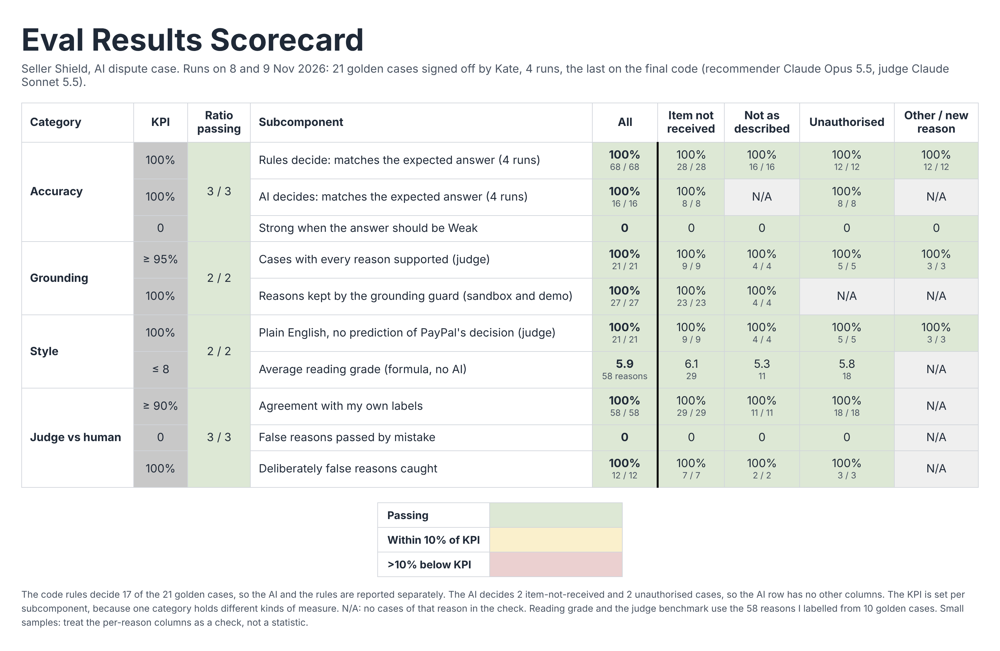
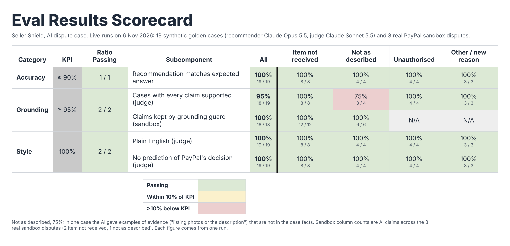

# Eval results scorecard

## All metrics (8 Nov 2026)

| Area | Metric | How it's checked | Target | Result |
|---|---|---|---|---|
| Rules | Golden cases the rules decide match the expected answer | golden-check, plus unit tests with no AI | 17 / 17 | 17 / 17 on all 3 runs |
| AI | Golden cases the AI decides (G01, G03, G20, G21) match the expected answer | golden-check, 3 runs | 4 / 4 each run | 4 / 4 on all 3 runs |
| AI | Strong when the expected answer is Weak | golden-check | 0 | 0 in 3 runs |
| Grounding | Cases where every reason is supported | AI judge | ≥ 95% | 21 / 21 (100%) |
| Grounding | Reasons kept by the grounding guard (sandbox disputes) | Code | 100% | 18 / 18 (6 Nov recordings, since re-recorded) |
| Style | Plain English, no prediction of PayPal's decision | AI judge, plus a filter in code | 100% | 21 / 21 |
| Style | Average reading grade of the reasons | Flesch-Kincaid formula, no AI (`scripts/readability-check.ts`) | 8 or below | 5.9 (recorded answers and benchmark reasons) |
| Judge | Agreement with Kate's labels | 58 reasons Kate labelled | ≥ 90% | 58 / 58 |
| Judge | False reasons passed by mistake | Same benchmark | 0 | 0 |
| Judge | Deliberately false reasons caught | 12 planted reasons | all | 12 / 12 |
| Code | Unit tests passing | node test | all | 228 / 228 |

Reading grade: about 1 reason in 6 is above grade 8. Most of these use PayPal's own terms, such as "eligible for Seller Protection" and "proof of fulfillment", which the formula counts as hard words but a PayPal seller knows. The formula measures sentence and word length, not clarity, so it sits next to the judge's plain English check.

Golden set: 21 cases, 3 runs on 8 Nov 2026, 63 of 63 answers matched. Judge: Claude Sonnet 5.5 on the same 21 cases, after the prompt change that added PayPal's rules.

## 6 Nov 2026 detail

The table and image below are from 6 Nov, before the 8 Nov changes, kept for the record.

| Category | KPI | Ratio passing | Subcomponent | All | Item not received | Not as described | Unauthorised | Other / new reason |
|---|---|---|---|---|---|---|---|---|
| Accuracy | ≥ 90% | 1 / 1 | Recommendation matches expected answer | **100%** (19/19) | 100% (8/8) | 100% (4/4) | 100% (4/4) | 100% (3/3) |
| Grounding | ≥ 95% | 2 / 2 | Cases with every claim supported (judge) | **95%** (18/19) | 100% (8/8) | 75% (3/4) | 100% (4/4) | 100% (3/3) |
| | | | Claims kept by grounding guard (sandbox) | **100%** (18/18) | 100% (12/12) | 100% (6/6) | N/A | N/A |
| Style | 100% | 2 / 2 | Plain English (judge) | **100%** (19/19) | 100% (8/8) | 100% (4/4) | 100% (4/4) | 100% (3/3) |
| | | | No prediction of PayPal's decision (judge) | **100%** (19/19) | 100% (8/8) | 100% (4/4) | 100% (4/4) | 100% (3/3) |

Below KPI: Not as described, 75% on the judge check (one case added evidence examples that are not in the facts).

## What the scores cover (8 Nov 2026, second review S8)

- **Most golden cases are decided by the rules, not the model.** recommend() applies the rules in lib/proof.ts after the model, then the eligibility check, so a rule result replaces the model's answer. With the pinned clock (5 Nov 2026), the rules decide 17 of the 21 golden cases. The model decides only 4: G01, G03, G20 and G21. The accuracy figure is therefore mainly a check of the rules. Report the model-decided cases separately: "AI X/4 on the cases the rules leave to it, rules 17/17, checked without the AI" (`lib/eval-answers.test.ts`, `lib/proof.test.ts`).
- **G20 and G21 are built the way the case screen builds them.** They hold an order and card answers, and the golden and judge checks turn these into an answer with caseAnswer(), the same function the screen uses. A no-AI test confirms that the rules leave both to the model.
- **The judge only matters where the screen shows the model's words.** When a rule decides a case, the screen shows the rule's reasons (ruleReasons), not the model's claims.
- **Recorded answers on the screen.** The screen never calls the model live. It shows recorded answers (lib/recorded/recommendations.json). Each new recording keeps the answer it was made from, and the screen does not show a recording made from other facts. `scripts/stale-check.ts` lists recordings to re-record. The figures at the top are from the 8 Nov runs, which include G20 and G21.

## Judge benchmark against a human (8 Nov 2026)

Kate labelled 58 reasons from 10 golden cases (G01, G02, G03, G05, G08, G10, G13, G16, G20, G21) as supported or not, without seeing the judge's verdicts. Judge: Claude Sonnet 5.5. Files: `docs/judge-benchmark/`.

| Check | Target | First run | After the prompt change | Status |
|---|---|---|---|---|
| Judge agrees with the human label | ≥ 90% | 56 / 58 (97%) | 58 / 58 (100%) | Pass |
| Reasons the human marked not supported but the judge passed | 0 | 0 | 0 | Pass |
| Deliberately false reasons the judge caught | all | not tested | 12 / 12 | Pass |

- **First run: both disagreements were the judge being stricter than the human.** G02-3 ("the rule requires tracking, so this dispute does not meet it") and G10-4 ("protection eligibility does not help here, since the address does not match") are conclusions from PayPal's rules, which the judge wasn't given, so it called them invented. Kate judged them correct.
- **The change:** the judge prompt now lists PayPal's Seller Protection rules as known facts, and two checks borrowed from Opik's Hallucination metric: a fact given to the wrong party is not supported, and a simplification that changes the meaning is not supported. The same 58 reasons were judged again with `scripts/judge-rebenchmark.ts`.
- **False reasons:** all 58 real reasons were true, so the first run couldn't show whether the judge catches a false one. 12 deliberately false reasons were added (`planted-false-8-nov.csv`): wrong dates and amounts, a fact given to the wrong party, invented evidence, contradictions of the facts, and wrong rule conclusions. They were judged in separate calls, so they couldn't sway the verdicts on the 58. The judge caught all 12.
- **Limits:** 70 reasons from one run is a small sample, and the false reasons were written by hand, so they may be easier to spot than a model's own mistakes. The judge stays a supporting check.

## Run history and detail

Only measured results are shown. The tables below are the 6 Nov 2026 run, kept for the record, with the golden and judge checks run on the same code (recommender: Claude Opus 5.5, judge: Claude Sonnet 5.5).

Status key: **Pass** meets the target. **Near** is within 10% of the target. **Below** is more than 10% under the target.

## Summary

| Category | Target | Subcomponent | Result | Status |
|---|---|---|---|---|
| Accuracy | ≥ 90% | Golden-set match rate (19 synthetic cases), after the G03 fix | 19 / 19 (100%) | Pass |
| Accuracy | ≥ 90% | Golden-set stability: 3 runs on the final prompt | 57 / 57 (100%) | Pass |
| Accuracy | ≥ 90% | Golden-set match rate, first run before the fix | 18 / 19 (95%) | Pass |
| Accuracy | 100% | Red-flag subset match (7 cases, 5 Nov 2026) | 7 / 7 (100%) | Pass |
| Grounding | ≥ 95% | Cases where the judge found every claim supported | 18 / 19 (95%) | Pass |
| Grounding | 0% | Claims dropped by the grounding guard (3 sandbox cases) | 0 / 18 (0%) | Pass |
| Style | 100% | Cases judged plain English | 19 / 19 (100%) | Pass |
| Style | 100% | Cases judged free of outcome predictions | 19 / 19 (100%) | Pass |
| Style | 0% | Claims that predict PayPal's decision (3 sandbox cases, regex) | 0 / 18 (0%) | Pass |
| Style | 100% | Claims citing at least one case fact (3 sandbox cases) | 18 / 18 (100%) | Pass |
| Code checks | 100% | Unit tests passing | 150 / 150 (100%) | Pass |

## By dispute reason (golden set)

| Subcomponent | All (19) | Item not received (8) | Not as described (4) | Unauthorised (4) | Other or new reason (3) |
|---|---|---|---|---|---|
| Golden match rate, after the fix | 19 / 19 (100%), Pass | 8 / 8 (100%), Pass | 4 / 4 (100%), Pass | 4 / 4 (100%), Pass | 3 / 3 (100%), Pass |
| Golden match rate, 3 runs on the final prompt | 57 / 57 (100%), Pass | 24 / 24 (100%), Pass | 12 / 12 (100%), Pass | 12 / 12 (100%), Pass | 9 / 9 (100%), Pass |
| Golden match rate, first run | 18 / 19 (95%), Pass | 8 / 8 (100%), Pass | 4 / 4 (100%), Pass | 3 / 4 (75%), Below | 3 / 3 (100%), Pass |
| Judge: all claims supported, latest run | 18 / 19 (95%), Pass | 8 / 8 (100%), Pass | 3 / 4 (75%), Below | 4 / 4 (100%), Pass | 3 / 3 (100%), Pass |

## What the checks caught

- **G03 (unauthorised, expected FIGHT, got YOUR_CALL with low confidence).** The seller's shipment proof (PayPal's notice date, the shipment date, and the shipping address match) was never passed to the model, so it couldn't see the proof and played safe.
- **Fix (6 Nov 2026):** those three answers are now passed to the model as facts, with a note on the 2-day rule, and a unit test covers it. The rerun gave G03 FIGHT with high confidence, and 19 of 19 overall. Three runs on the final prompt each scored 19 of 19 (57 of 57).
- **G05 (not as described), one unsupported claim.** The AI wrote that PayPal asks for evidence "such as listing photos or the description". The evidence type is right, but the examples are not in the case facts. 4 of 5 claims in that case were supported.
- **Judge reliability (fixed).** The judge once sent a corrected second answer, which crashed the run, and it flagged true "you confirmed" claims because it didn't know those facts are the seller's own answers. The parser now uses the last valid answer, and the fact notes say which facts are the seller's answers.

## Notes

- The 3 sandbox cases are the real PayPal sandbox disputes recorded on 6 Nov 2026: 2 refund recommendations (high confidence) and 1 seller's-call recommendation (low confidence).
- Model output can vary between runs. The golden set was run three times on the final prompt to check this, and all 57 answers matched. The judge figures come from a single run.
- The judge is also an AI model, so its scores support the other checks rather than prove them.
